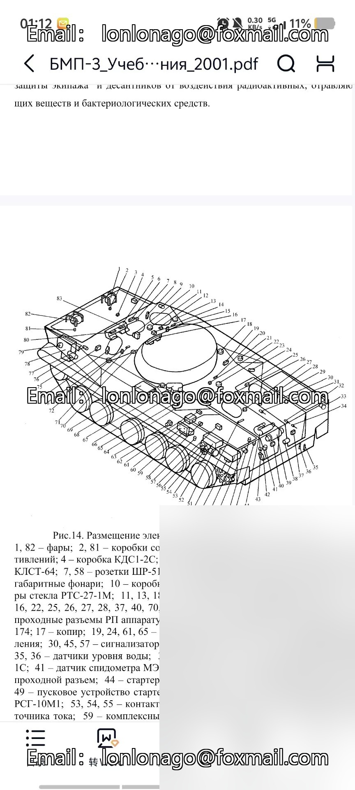
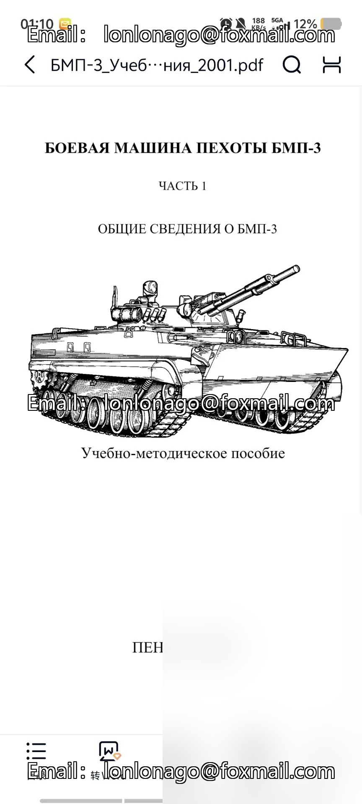
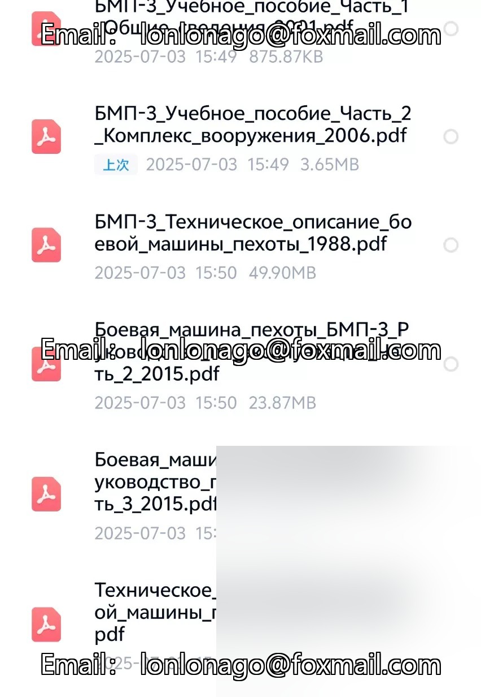
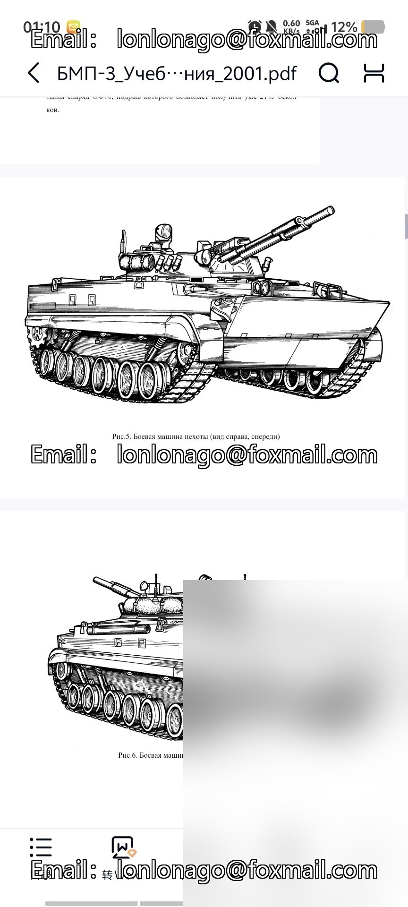
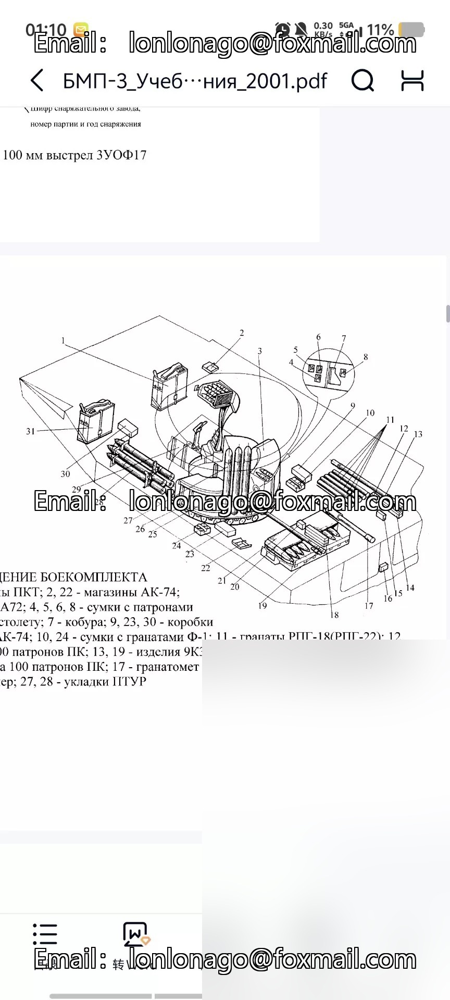
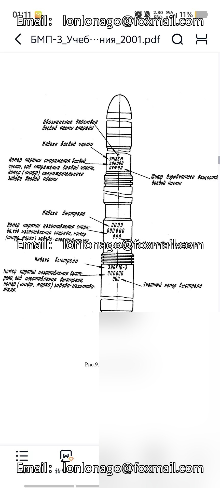

# Soviet/Russian BMP-3 infantry tank technical literature and teaching materials, totaling 6 volumes.

## Body

Soviet/Russian BMP-3 infantry tank technical literature and teaching materials, totaling 6 volumes. Including:

Instruction manual (Teaching manual):

Part 1: Overview (2001, 875KB)

2. Part: Weapon System (2006, 3.65MB)

Technical description document (1988, 49.9MB)

Usage and maintenance manual (Operation guide):

Part 2 (2015, 23.87MB)

Part Three (2015, 31.4MB)

Technical maintenance manual (1996, 2.12MB)

These Russian original documents have important reference value for the study of the weapon system, technical parameters, operational norms, and maintenance and preservation of the BMP-3 infantry tank. The document time span ranges from 1988 to 2015 and includes technical materials of that tank in multiple periods.

The materials cover technical literature and teaching materials for the Soviet/Russian BMP-3 infantry combat vehicle, totaling six volumes including teaching manuals, technical documentation, usage and maintenance guides and technical maintenance manuals.

<!-- AI_ENRICHED -->

## Images

## Payment

Here is a pay link on Stripe ( https://buy.stripe.com/3cs8yP7sY87d0vu9AB ). Please contact me lonlonago@foxmail.com after funding $89, and I will send you a complete data files , thank you!

